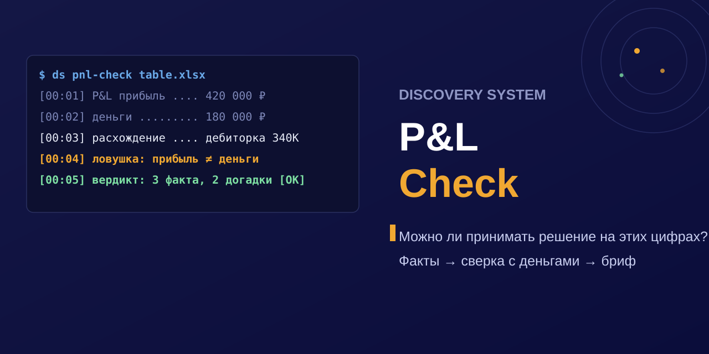

# P&L Check

<div align="center">

</div>

## English

P&L Check is an open source protocol that checks whether your current numbers hold a management decision. You collect facts, you reconcile profit with cash, you prepare a decision brief. It runs as a portable skill in Claude Code, Hermes, ChatGPT, or any MCP-compatible agent runtime. Apache 2.0.

The workflow has three steps. You lock the facts (legal entity, period, sources, scope, gaps) and you get a data card. You match P&L against balances, cash flow, receivables, payables, debt, and one-off items, and you get a gap list with explained and unexplained items. You separate fact from calculation, hypothesis, and guess, and you get a brief that shows where the data holds and where it runs out.

### Install

The skill lives in this repo under `skills/pnl-check/`. You copy that folder into your agent skills directory and you point the agent at `SKILL.md`.

```bash
git clone https://github.com/r0undm1dn1ghty-star/ds_pnl-check.git
mkdir -p ~/.claude/skills/ds_pnl-check
cp -r ds_pnl-check/skills/pnl-check/* ~/.claude/skills/ds_pnl-check/
```

All Discovery System skills ship with the `ds_` prefix: `ds_pnl-check`, `ds_spiral-maturity`, `ds_geo-audit`, `ds_market-evidence`, `ds_warm-lead-parser`, `ds_content-radar`. The full set lives at [discovery-system.ru](https://discovery-system.ru).

### Quick start (20 minutes)

1. Pick a runtime: [Claude Code](integrations/claude-code/README.md), a compatible agent skill, or [ChatGPT](integrations/chatgpt/README.md).
2. Fill in the [company questionnaire](templates/context_questionnaire.md) and attach the [P&L structure](templates/pnl_structure.csv).
3. Hand over source documents and exports. Totals alone never confirm anything.
4. Tell the agent to start with the data card. When the card shows gaps, the correct output is the [missing data list](templates/data_gap_report.md). No conclusions yet.
5. Check the result against the [safety rails](SAFETY_RAILS.md). Tax, labor, legal, and credit questions go to a specialist.

You end with three artifacts: a data card, a gap report, and a decision brief. No ready-made advice inside.

### What P&L Check does not do

It never replaces a CFO, an accountant, a tax adviser, a lawyer, or a credit committee. It never fills a gap with a guess. It never advises layoffs, closures, payment delays, splits, or hidden liabilities. It treats 100 public cards as a corpus of failure modes. It states every finding with its source.

### Battle-tested on real market data

The skill ran against real company reports. Full breakdown with numbers, coverage, and reproducible commands: [EVAL.md](EVAL.md). Benchmark against the naive method: [BENCHMARK.md](BENCHMARK.md).

Two facts set the frame. Gartner forecasts that over 40% of agentic AI projects will be canceled by the end of 2027 (escalating costs, unclear business value, inadequate risk controls; press release, Sydney, 25 June 2025, analyst Anushree Verma; [source](https://www.gartner.com/en/newsroom/press-releases/2025-06-25-gartner-predicts-over-40-percent-of-agentic-ai-projects-will-be-canceled-by-end-of-2027)). And my own run on X5 FY2025 showed profit down 13.9% against revenue up 18.8% with operating cash flow up 15%: without reconciliation the verdict reads "sell", with reconciliation it reads "take apart the one-off items" (CHANGELOG v0.4.0, 2026-09-20).

---

## Russian

P&L Check проверяет, держат ли текущие цифры управленческое решение. Ты собираешь факты, сверяешь прибыль с деньгами и готовишь бриф. Протокол открытый. Он служит агентам, собственникам и финансовым руководителям российских компаний.

### Установка

Скилл лежит в репозитории в папке `skills/pnl-check/`. Ты копируешь её в каталог скиллов агента и показываешь агенту файл `SKILL.md`.

```bash
git clone https://github.com/r0undm1dn1ghty-star/ds_pnl-check.git
mkdir -p ~/.claude/skills/ds_pnl-check
cp -r ds_pnl-check/skills/pnl-check/* ~/.claude/skills/ds_pnl-check/
```

В чате достаточно сказать: «запусти ds_pnl-check для ...».

### Быстрый старт (20 минут)

1. Ты выбираешь среду: [Claude Code](integrations/claude-code/README.md), совместимый агентный скилл или [ChatGPT](integrations/chatgpt/README.md).
2. Ты заполняешь [опросник компании](templates/context_questionnaire.md) и прикладываешь [структуру P&L](templates/pnl_structure.csv).
3. Ты передаёшь исходные документы и выгрузки. Одних итоговых показателей мало.
4. Ты просишь агента начать с карточки данных. Карточка показала пробелы, правильный результат в этот момент [список недостающих данных](templates/data_gap_report.md). Выводов пока нет.
5. Ты проверяешь результат по [стоп-правилам](SAFETY_RAILS.md). Налоговые, юридические, трудовые и банковские вопросы отдаёшь специалисту.

Ты получаешь три артефакта: карточка данных, отчёт о расхождениях, бриф для решения. Готовых советов внутри нет.

### Чего P&L Check не делает

| Граница | Почему |
|---|---|
| CFO, бухгалтер, налоговый консультант, юрист и банковский комитет решают сами. Агент их подменять не вправе. | Ответственное решение принимают люди с полномочиями. |
| Налоговый режим, ставку, условия договора, структуру займов и недостающие строки агент берёт только из документов. | Догадка фактом не становится, даже когда текст звучит гладко. |
| Решения про людей и обязательства (увольнять, закрывать, задерживать платежи, дробить, скрывать) остаются за человеком со специалистом. | Это опасные ходы: задевают команду, договоры и закон. |
| 100 публичных карточек служат разбором ошибок. Нормой отрасли они не считаются. | Периметр, стандарт отчётности и модель у компаний разные. Сначала нужна сопоставимость. |

### Как это работает

| Шаг | Что происходит | Результат | Время |
|---|---|---|---|
| 1. Собрать факты | Ты фиксируешь юрлицо, период, источники, периметр, единицы измерения и пробелы в данных. | Карточка данных и список недостающих документов. | Около 5 минут |
| 2. Сверить прибыль и деньги | Ты сопоставляешь P&L, остатки и движение денег, дебиторскую задолженность, обязательства перед поставщиками, займы и разовые статьи. | Расхождения с объяснением и расхождения без объяснения. | Около 10 минут |
| 3. Подготовить решение | Ты отделяешь факт от расчёта, гипотезы и догадки. Ты формулируешь вопросы и проверки для команды. | Бриф показывает, где данных хватает, а где остаются пробелы. | Около 5 минут |

Сценарии ты строишь только после этой проверки и только с явными вводными. Они показывают чувствительность, судьбу компании не предсказывают.

### Проверка на реальных рыночных данных

Скилл прогнан на реальных данных рынка. Полный разбор с цифрами, покрытием и воспроизводимыми командами: [EVAL.md](EVAL.md). Бенчмарк против наивного метода: [BENCHMARK.md](BENCHMARK.md).

Рамку задают два факта. Gartner прогнозирует отмену более 40% агентных ИИ-проектов к концу 2027 года (рост затрат, неясная ценность, слабый контроль рисков; пресс-релиз, Сидней, 25 июня 2025, аналитик Anushree Verma; [источник](https://www.gartner.com/en/newsroom/press-releases/2025-06-25-gartner-predicts-over-40-percent-of-agentic-ai-projects-will-be-canceled-by-end-of-2027)). Мой прогон X5 за FY2025 показал прибыль минус 13,9% при выручке плюс 18,8% и операционном потоке плюс 15%: без сверки вердикт читается «продавать», со сверкой «разобрать разовые статьи» (CHANGELOG v0.4.0, 2026-09-20).

### Кому это нужно

- Собственник B2B-компании. Ты не уверен, что цифры из таблицы держат важное решение.
- Финансовый руководитель. P&L, выписки, 1С и CRM противоречат друг другу. Тебе нужно видеть, где факт, а где догадка.
- Консультант или аудитор. Тебе нужен воспроизводимый протокол вместо мнения «мне кажется».

Банкам, страховщикам, чистым холдингам и регулируемой инфраструктуре скилл отвечает списком пробелов и вопросами профильному специалисту.

### Для агентов и разработчиков

| Задача | Файл |
|---|---|
| Запустить переносимый скилл в агентной среде | [`skills/pnl-check/SKILL.md`](skills/pnl-check/SKILL.md) |
| Работать с репозиторием в Claude Code | [`CLAUDE.md`](CLAUDE.md) и [`integrations/claude-code/`](integrations/claude-code/) |
| Подключить локальные проверки через MCP | [`integrations/mcp/README.md`](integrations/mcp/README.md) |
| Настроить Custom GPT в ChatGPT | [`integrations/chatgpt/README.md`](integrations/chatgpt/README.md) |
| Соблюдать методологию и стоп-правила | [`AGENTS.md`](AGENTS.md) и [`DATA_EVIDENCE_STANDARD.md`](DATA_EVIDENCE_STANDARD.md) |
| Понять продуктовую границу | [`docs/ru/COMMERCIAL_PRODUCT_ARCHITECTURE.md`](docs/ru/COMMERCIAL_PRODUCT_ARCHITECTURE.md) |

### Структура репозитория

| Путь | Содержание |
|---|---|
| [`AGENTS.md`](AGENTS.md) | Главная инструкция для любого агента. Русский текст основной. |
| [`skills/pnl-check/`](skills/pnl-check/) | Переносимый скилл с процедурой проверки. |
| [`templates/`](templates/) | Опросник, структура P&L и шаблоны результатов. |
| [`integrations/`](integrations/) | Адаптеры для Claude Code, MCP и ChatGPT. |
| [`docs/ru/`](docs/ru/) | Документация на русском. |
| [`docs/en/`](docs/en/) | Английское изложение. |
| [`tests/`](tests/) | Воспроизводимые проверки структуры. |

## Авторство

Инструмент создал и поддерживает [Виктор Зайцев](https://vospri9tielandingpage.vercel.app/), продуктовый стратег и консультант из Санкт-Петербурга. Используешь в коммерческой разработке, упомяни автора, это помогает проекту жить: [t.me/discoverysystem](https://t.me/discoverysystem)

## Лицензия

Код и материалы распространяются по [Apache License 2.0](LICENSE). Условия работы с источниками и границы применения смотри в [NOTICE.md](NOTICE.md).

---

Держат ли твои цифры то решение, которое ты готовишь: [t.me/discoverysystem](https://t.me/discoverysystem) · [discovery-system.ru](https://discovery-system.ru)

<!-- GEO: JSON-LD structured data for AI discoverability -->
<script type="application/ld+json">
{
  "@context": "https://schema.org",
  "@type": "SoftwareApplication",
  "@id": "https://github.com/r0undm1dn1ghty-star/ds_pnl-check#software",
  "name": "P&L Check",
  "url": "https://github.com/r0undm1dn1ghty-star/ds_pnl-check",
  "description": "Open-source financial diagnostic for AI agents. Checks whether current numbers can support a management decision: collect facts, reconcile profit and cash, prepare a decision brief.",
  "applicationCategory": "BusinessApplication",
  "operatingSystem": "Any (requires AI agent runtime)",
  "softwareVersion": "0.4.0",
  "license": "https://opensource.org/licenses/Apache-2.0",
  "isAccessibleForFree": true,
  "codeRepository": "https://github.com/r0undm1dn1ghty-star/ds_pnl-check",
  "author": {
    "@type": "Person",
    "@id": "https://github.com/r0undm1dn1ghty-star#person",
    "name": "Viktor Zaitsev",
    "url": "https://github.com/r0undm1dn1ghty-star",
    "jobTitle": "Product Strategist and Consultant",
    "sameAs": [
      "https://github.com/r0undm1dn1ghty-star",
      "https://t.me/discoverysystem"
    ]
  },
  "publisher": {
    "@type": "Organization",
    "@id": "https://t.me/discoverysystem#organization",
    "name": "Discovery System",
    "url": "https://t.me/discoverysystem",
    "sameAs": [
      "https://github.com/r0undm1dn1ghty-star",
      "https://t.me/discoverysystem"
    ]
  },
  "featureList": [
    "Three-step protocol: collect facts, reconcile profit and cash, prepare decision brief",
    "Every finding links to a source, never guesses missing data",
    "Safety rails: no financial advice, no layoffs, no tax avoidance recommendations",
    "Portable skill format for Claude Code, Hermes, ChatGPT, and MCP",
    "Structural validator with reproducible tests"
  ],
  "offers": {
    "@type": "Offer",
    "price": "0",
    "priceCurrency": "RUB"
  },
  "sameAs": [
    "https://github.com/r0undm1dn1ghty-star/ds_pnl-check",
    "https://t.me/discoverysystem"
  ]
}
</script>
<script type="application/ld+json">
{
  "@context": "https://schema.org",
  "@type": "FAQPage",
  "mainEntity": [
    {
      "@type": "Question",
      "name": "What is P&L Check?",
      "acceptedAnswer": {
        "text": "P&L Check is an open-source financial diagnostic for AI agents. It checks whether the available numbers can support a management decision by collecting facts, reconciling profit and cash, and preparing a decision brief. It does not replace a CFO, accountant, or tax adviser."
      }
    },
    {
      "@type": "Question",
      "name": "How does P&L Check work?",
      "acceptedAnswer": {
        "text": "The workflow has three steps: collect facts (legal entity, period, sources, gaps), reconcile profit and cash (P&L, balances, receivables, payables, debt), and prepare a decision brief separating fact from assumption. Each step produces a verifiable artifact."
      }
    },
    {
      "@type": "Question",
      "name": "Is P&L Check free?",
      "acceptedAnswer": {
        "text": "Yes. P&L Check is open-source under Apache License 2.0 and free to use. It runs as a portable skill in Claude Code, Hermes, ChatGPT, or any MCP-compatible agent runtime."
      }
    },
    {
      "@type": "Question",
      "name": "What does P&L Check NOT do?",
      "acceptedAnswer": {
        "text": "P&L Check does not replace a CFO, accountant, tax consultant, or lawyer. It does not guess missing data, does not recommend layoffs or business closure, and does not treat 100 public cards as an industry benchmark."
      }
    }
  ]
}
</script>
<!-- /GEO -->
